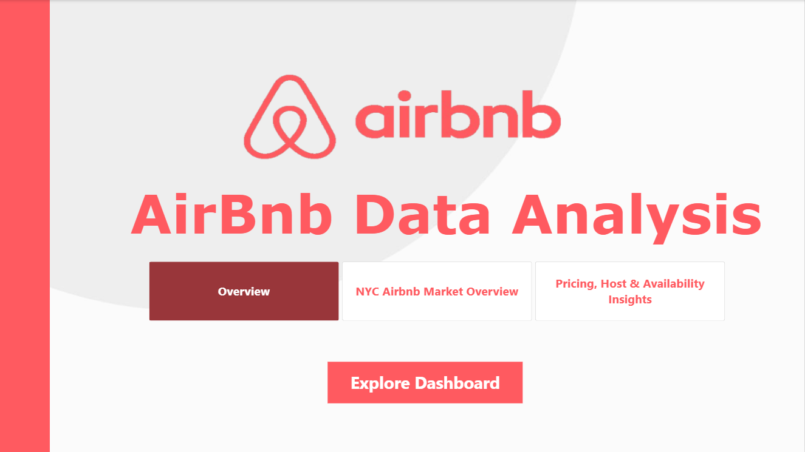
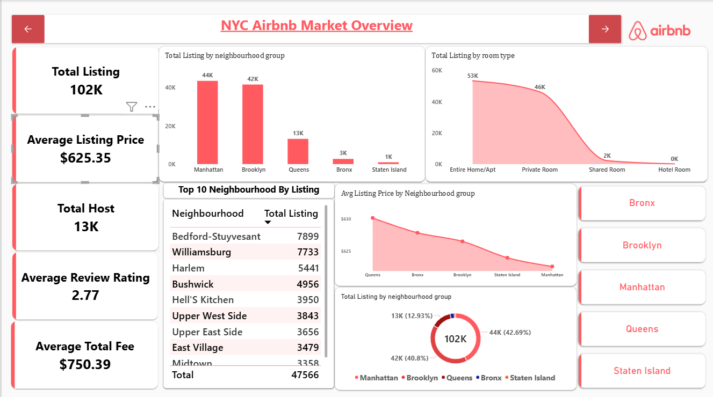
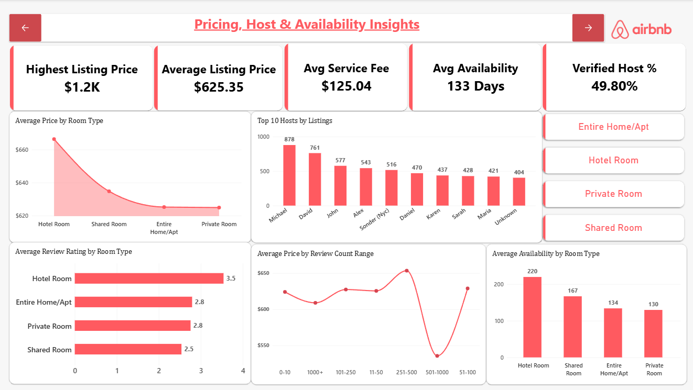

# Airbnb NYC Data Analysis | Market, Pricing, Host & Availability Insights

**Python · Power BI · Excel**

---

## Executive Snapshot (3-Minute Read)

**Business Context:** Airbnb's NYC market is large (102K listings) and spread across five boroughs, hundreds of neighbourhoods and four room types. This project analyses the listing data to understand where supply is concentrated, how listings are priced, who the hosts are, and how availability differs across room types.

**Approach:** The dataset was cleaned and prepared in Python, and the findings were presented in an interactive three-page Power BI dashboard.

### Dashboard Walkthrough

---

## Key Findings

- **83.5% of listings sit in two boroughs** — Manhattan (44K, 42.69%) and Brooklyn (42K, 40.8%) out of 102K listings
- **Brooklyn has the two largest neighbourhoods** — Bedford-Stuyvesant (7,899) and Williamsburg (7,733), while Manhattan's supply is spread across many neighbourhoods
- **Two room types make up ~97% of the market** — Entire Home/Apt (53K) and Private Room (46K)
- **Listing prices barely change by borough** — average $625.35, with only a ~$5–7 spread (under 1%) between boroughs
- **Guests pay ~20% above the listing price** — average total price $750.39 vs listing price $625.35, a gap equal to the $125.04 average service fee
- **The host base looks commercially operated** — 13K hosts manage 102K listings (~8 per host), and the top host has roughly 870 listings
- **Hotel and shared rooms stay open far longer** — Hotel Room averages 220 available days vs 130 for Private Room

**Why This Matters:** The NYC Airbnb market depends on a few boroughs, a few neighbourhoods and a relatively small set of large hosts. Prices are far more uniform than expected across boroughs and room types, and the real cost to guests is about one-fifth higher than the listing price suggests.

---

## 📌 Project Overview

This project delivers an end-to-end analysis of the NYC Airbnb listings dataset using Python and Power BI.

The business question: *"What does the NYC Airbnb market look like in terms of supply, pricing, hosts and availability?"*

As the analyst on this project, the focus was on three areas — **market structure** (borough, neighbourhood and room type), **pricing** (listing price, service fee and total price) and **hosts & availability** (host concentration, verification, ratings and open days).

---

## 📊 Executive Summary

### Dashboard Overview — NYC Airbnb Market Overview

**Supply by Borough**
- Total listings: 102K · Total hosts: 13K
- Manhattan 44K (42.69%) · Brooklyn 42K (40.8%) · Queens 13K (12.93%) · Bronx 3K · Staten Island 1K
- Manhattan and Brooklyn together hold ~83.5% of listings — changes in demand, regulation or host behaviour there would move the whole market

**Top Neighbourhoods**
- Bedford-Stuyvesant 7,899 · Williamsburg 7,733 · Harlem 5,441 · Bushwick 4,956 · Hell's Kitchen 3,950
- The top 10 neighbourhoods hold 47,566 listings (~47% of the market)
- Manhattan leads at borough level because its supply is spread across many neighbourhoods; Brooklyn's is concentrated in a few very large ones

**Room Types**
- Entire Home/Apt 53K (~52%) · Private Room 46K (~45%) · Shared Room 2K
- Hotel-style and shared stays are marginal in listing supply

**Pricing by Borough**
- Average listing price: $625.35
- Queens is highest at about $630 and Manhattan lowest at just under $625 — location does not appear to drive listing price in this dataset

---

### Pricing, Host & Availability Insights

**Pricing**
- Highest listing price: $1.2K · Avg listing price: $625.35 · Avg service fee: $125.04
- Avg total price $750.39 — guests pay ~20% above the listing price
- Hotel Room is highest at about $666, Shared Room about $635, Entire Home/Apt and Private Room about $625
- Shared rooms are priced above entire homes and private rooms — listing price does not follow the usual product hierarchy

**Hosts**
- 13K hosts manage 102K listings (~8 per host)
- The top host has roughly 870 listings and the tenth about 400
- Company operators such as "Sonder (Nyc)" appear in the top 10, pointing to professional, multi-listing supply
- Verified Host %: 49.80% — verification is split almost evenly

**Availability**
- Average availability: 133 days (~36% of the year)
- Hotel Room 220 days · Shared Room 167 · Entire Home/Apt 134 · Private Room 130
- Hotel Room availability is ~69% higher than Private Room

**Reviews & Ratings**
- Hotel Room has the highest average rating (~3.5), followed by Entire Home/Apt (~2.8), Private Room (~2.75) and Shared Room (~2.5)
- Listings with very high review counts are priced below average — the 501–1000 review band averages about $535, roughly 14% below the overall $625.35

---

## 🔍 Insights Deep Dive

### Supply
- The market is effectively a Manhattan-and-Brooklyn market, with Queens adding 12.93%
- The Bronx and Staten Island together are under 4% of listings

### Room Types
- Entire Home/Apt and Private Room dominate; hotel and shared segments are small
- Hotel Room leads on price, rating and availability, but it is a very small segment

### Pricing
- Borough-level and room-type price gaps are small (about $40 at most between room types)
- The $125.04 service fee adds about one-fifth on top of the listing price

### Hosts
- With ~8 listings per host on average, supply is not mainly individuals renting a spare room
- Platform health and listing quality depend heavily on a small set of large operators

### Availability & Reviews
- Hotel and shared inventory is open for far more days than residential-style listings
- The most-reviewed listings are not the most expensive

---

## 🧠 Key Analytical Decisions

- **Neighbourhood identification:** Missing neighbourhood values were identified with **GeoPandas** using location coordinates, so some neighbourhood assignments are estimated rather than exact matches
- **Listing-level view:** All findings describe listing price, available days and review counts — not revenue, occupancy or bookings

---

## 🛠 Tools Used

- **Python** — data cleaning and preparation
- **Power BI** — interactive three-page dashboard
- **Excel** — dataset viewing

---

## 📬 Contact and Feedback

This project was developed as part of a portfolio demonstrating data analysis skills across Python and Power BI.

**Data Analyst:** Manjeet Gupta  
**LinkedIn:** [Manjeet Gupta](https://www.linkedin.com/in/manjeet-gupta-731409296/)  
**Email:** [manjeet.tcsc@gmail.com](mailto:manjeet.tcsc@gmail.com)

*Data Source: [Airbnb Open Data (Kaggle)](https://www.kaggle.com/datasets/arianazmoudeh/airbnbopendata) · Tools: Python · Power BI*
